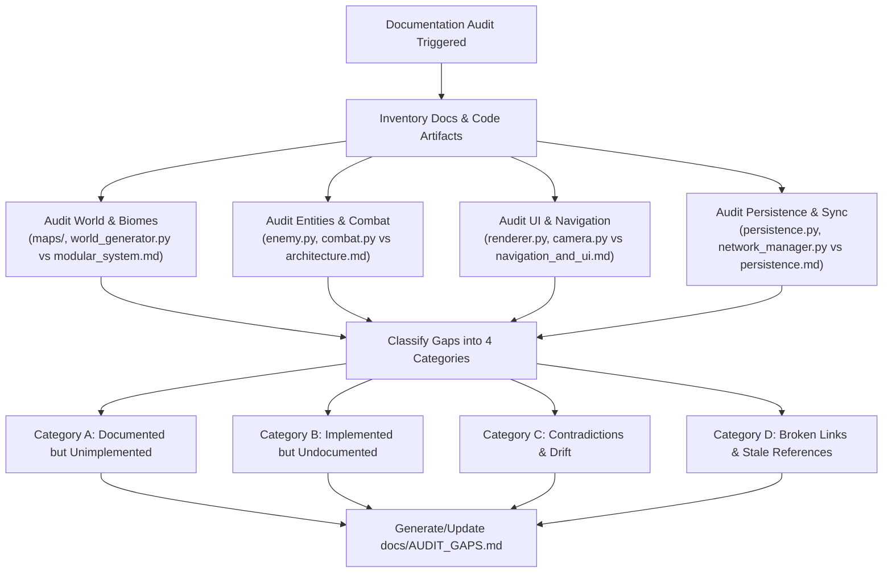

# Documentation Audit & Alignment Skill (`doc-audit`)

This skill provides a standardized, repeatable procedure for auditing, aligning, and maintaining
the documentation of **Avoid Rain** against the active Python codebase, map data, and assets.

Use this skill whenever:
- Preparing for a milestone release or phase transition.
- Syncing documentation after large feature additions or refactors.
- Auditing discrepancies between game mechanics and design documentation.
- Verifying link integrity, archiving standards, and convention compliance across `docs/`.

---

## 1. Safety Guardrails & Principles

1. **Zero Source Code Modification**: A documentation audit must **never** modify game source code
   (`*.py`), level maps (`maps/*`), or assets (`assets/*`). All updates must be confined to `docs/`,
   `AGENTS.md`, and audit report files.
2. **Lore Preservation**: Never delete active world-building lore, narrative fragments, or artistic
   reference notes from `docs/world_and_lore.md`, `docs/reference.md`, or `docs/extended-notes/`.
   If a lore feature is not yet in code, document it as a pending roadmap item rather than pruning it.
3. **Continuous Cleanup Protocol**: Enforce the repository's strict task lifecycle rule: completed
   tasks must be cut from the active section in `AGENTS.md` and archived in `docs/CHANGELOG.md`.

---

## 2. Phase 1: Convention Compliance & Structural Standards

The Avoid Rain repository enforces a **Hub-and-Spoke** documentation architecture with strict naming
and formatting patterns.

### 2.1 File Organization & Naming Standards

All documentation must reside in one of the following locations:

Path / Pattern                 | Purpose / Content Type                                | Naming Standard
:----------------------------- | :---------------------------------------------------- | :--------------
`AGENTS.md`                    | Central Hub: rules, context pointers, active task     | Exact name
`docs/architecture.md`         | Permanent technical architecture, schemas, state      | Lowercase snake_case
`docs/navigation_and_ui.md`    | Camera, Minimap, HUD, and Input Handling              | Lowercase snake_case
`docs/visual_style_and_assets.md` | Registry of sprites, tile sets, and art blueprints | Lowercase snake_case
`docs/world_and_lore.md`       | Manuscript lore, factions, geographical categories    | Lowercase snake_case
`docs/modular_system.md`       | Map serialization schemas and Master Loom assembly    | Lowercase snake_case
`docs/persistence.md`          | Save/load schemas, statistics, autosave mechanics     | Lowercase snake_case
`docs/backlog.md`              | Roadmap, deferred mechanics, feature proposals        | Lowercase snake_case
`docs/testing.md`              | Headless test execution, mock surfaces, coverage      | Lowercase snake_case
`docs/CHANGELOG.md`            | Historical archive of completed tasks and sprints     | Exact uppercase
`docs/reference.md`            | High-contrast action-RPG visual guides & palettes     | Lowercase snake_case
`docs/level_design_concept.md` | Macro room layouts (Figure-8 loops, choke nodes)      | Lowercase snake_case
`docs/extended-notes/*.md`     | Deep narrative lore, cutscenes, enemy HTML mocks      | Hyphenated lowercase

### 2.2 Task Archiving Convention (Continuous Cleanup Protocol)

Verify that `AGENTS.md` and `docs/CHANGELOG.md` adhere to the continuous archiving lifecycle:
- The active section in `AGENTS.md` must only contain the single currently active sprint task,
  or `## Active Task: [NONE]` when idle.
- Completed tasks must be archived at the bottom of `docs/CHANGELOG.md` using the exact format:
  ```markdown
  ## [ARCHIVED] <Descriptive Task Title> - <Month Year>
  - **Subsystem Category (`file/path.py`, `docs/spec.md`):**
    - Technical bullet points in past tense detailing concrete implementations.
    - Test coverage metrics and verification results.
  ```

### 2.3 Formatting & Link Integrity Rules

- **Line Length**: All markdown text should prioritize readability without overly stretched single-line blocks.
- **Link Formats**:
  - Relative links within `docs/` must point to valid files (e.g. `[Architecture](architecture.md)`).
  - Cross-references to source code must use valid relative paths (e.g. `[engine/combat.py](../engine/combat.py)`).
  - Code symbols must be wrapped in backticks (e.g. `GameState`, `check_sword_hit`, `SWORD_REACH`).

---

## 3. Phase 2: Code-vs-Docs Gap Analysis Protocol

Perform a systematic, subsystem-by-subsystem cross-examination comparing documentation against the codebase.



### 3.1 Subsystem Audit Checklist

Inspect the codebase using file reads and search commands to populate the audit:

#### 1. World, Maps, and Biomes
- Compare `constants.BIOME_PALETTES` and `constants.TILE_KEY` against `docs/reference.md` and `docs/modular_system.md`.
- Inspect `maps/` directory: check that all map files (`windy_ridge.json`, `swamp_mire.json`, `the_colophon.json`,
  `sanctuary_*.txt`, etc.) are documented in `docs/modular_system.md` or `docs/world_and_lore.md`.
- Check room assembly logic in `engine/world_generator.py` (symmetric sizing array `[120, 40, 120, 40, 120]`)
  against `docs/modular_system.md`.

#### 2. Enemies, Minibosses, and Bosses
- Compare `SYMBOL_REGISTRY` in `engine/world.py` and enemy classes in `engine/enemy.py`
  (`BatEnemy`, `SlugEnemy`, `FlutterEnemy`, `BindlingEnemy`, `SmearEnemy`, `SentryEnemy`, `Miniboss`)
  against `docs/architecture.md` and `docs/extended-notes/enemies/`.
- Check Boss implementation in `engine/boss.py` (`NightBoss`) and arena mechanics against `docs/architecture.md`.

#### 3. Combat, Physics, and Equipment
- Compare weapon constants and anomalous traits in `constants.py`, `engine/weapon.py`, and
  `engine/anomalous_weapon.py` (`INK_BLEED`, `VOID_STRIKE`, etc.) against `docs/architecture.md` Section 4.
- Verify combat parameters (sword reach, crescent arc radians, dash duration, parry window, block reduction)
  in `constants.py` match the combat specifications in `docs/architecture.md`.

#### 4. UI, Camera, and Visual Systems
- Check Minimap rules (radar color tokens, Sanctuary exclusion, safe circle ring) in `engine/minimap.py` and
  `rendering/renderer.py` against `docs/navigation_and_ui.md`.
- Check audio and debug text visibility controls (pause menu debug toggle, persistent audio HUD)
  against `docs/navigation_and_ui.md`.

#### 5. Persistence and Networking
- Check the save schema (`save_data.json`) in `engine/persistence.py` and `engine/stats.py`
  against `docs/persistence.md`.
- Check client/server network sync (UDP state replication, port reuse, timeout reconnection)
  in `engine/network_manager.py` against `docs/architecture.md`.

### 3.2 Gap Classification Categories

Sort all discovered issues into the following four categories:

1. **Category A (Documented but Unimplemented)**:
   - Features, weapons, enemies, or biomes planned in design docs but not yet found in the engine.
   - Example: Footnote spirits trading in `Market of Margins`, or unimplemented lore fragments.
2. **Category B (Implemented but Undocumented)**:
   - Mechanics, constants, tile types, or enemies present in code but missing from technical docs.
   - Example: New procedural clutter sprites (`ruins_rubble.png`, `swamp_flora.png`, `crypt_clutter.png`),
     or newly added enemy types (`SentryEnemy`).
3. **Category C (Contradictions & Drift)**:
   - Numerical values, names, or formulas that disagree between code and documentation.
   - Example: Sword reach documented as 40px but calibrated to 64px in `constants.py`.
4. **Category D: Broken Links & Stale References**:
   - Markdown links pointing to moved or deleted files, old prototype filenames, or dead anchors.

---

## 4. Phase 3: Safe Cleanup, Archiving, and Reporting

### 4.1 Safe Documentation Cleanup Rules

1. **Fix Broken Links**: Update stale markdown links in `docs/` to point to actual filenames and headers.
2. **Synchronize Constants**: Update documented numbers in `docs/architecture.md` and `docs/navigation_and_ui.md`
   to match canonical constants in `constants.py`.
3. **Catalog Undocumented Additions**: Add missing entries for newly added enemies, tiles, and rendering
   passes into `docs/visual_style_and_assets.md` and `docs/architecture.md`.
4. **Move Obsolete Proposals to Backlog**: If a documented feature was redesigned during development,
   move the old concept into `docs/backlog.md` under an `[Archived Proposal]` section rather than erasing it.

### 4.2 Audit Deliverable: `docs/AUDIT_GAPS.md`

Every full doc-audit run must produce or refresh `docs/AUDIT_GAPS.md` with the following structure:

```markdown
# Documentation Audit Report - <Date>

## 1. Executive Summary
- Total documents audited.
- Overall alignment score / state of documentation health.
- High-priority discrepancies identified.

## 2. Category A: Documented but Unimplemented Features
- [ ] Feature Name (Source: `docs/file.md`) - Description of pending implementation.

## 3. Category B: Implemented Mechanics Missing from Documentation
- [ ] Subsystem / Entity (Code: `engine/file.py`) - Description of missing documentation.

## 4. Category C: Value Mismatches & Contradictions
- Parameter / Mechanic: Documented value vs. Code value (`constants.py:XXX`).

## 5. Category D: Broken Links & Path Repairs
- Source file: Broken link target -> Corrected target.

## 6. Action Items & Remediation Plan
1. Documentation updates applied during this audit.
2. Recommended code or documentation follow-ups for future sprints.
```

---

## 5. Step-by-Step Audit Execution Runbook

When instructed to perform a documentation audit:

1. **Survey Documentation**:
   ```bash
   ls -la docs/
   ls -la docs/extended-notes/
   ```
2. **Scan Git History for Recent Doc Updates**:
   ```bash
   git log -n 15 --oneline -- docs/
   ```
3. **Inspect Active Task & Archiving Status**:
   - Check `AGENTS.md` for stray completed tasks that should be archived in `docs/CHANGELOG.md`.
4. **Scan Codebase Assets & Entities**:
   - Grep `SYMBOL_REGISTRY` in `engine/world.py`.
   - Grep `BIOME_PALETTES` and key constants in `constants.py`.
   - List generated assets in `assets/graphics/`.
5. **Verify Markdown Link Integrity**:
   - Check all relative file links across `docs/*.md`.
6. **Compile Findings**:
   - Write or update `docs/AUDIT_GAPS.md`.
7. **Synchronize Docs**:
   - Update `docs/architecture.md`, `docs/visual_style_and_assets.md`, and hub files to resolve Category B and C gaps.
8. **Verify Verification Tests**:
   - Run `pytest` to guarantee documentation edits did not break docstring tests or file path assertions.
