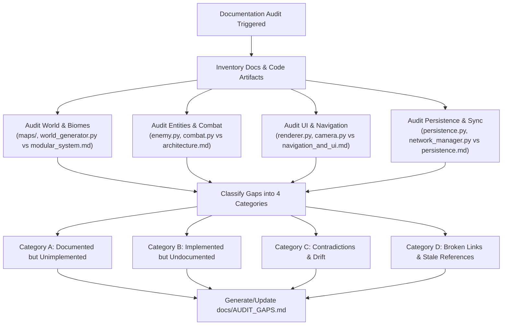
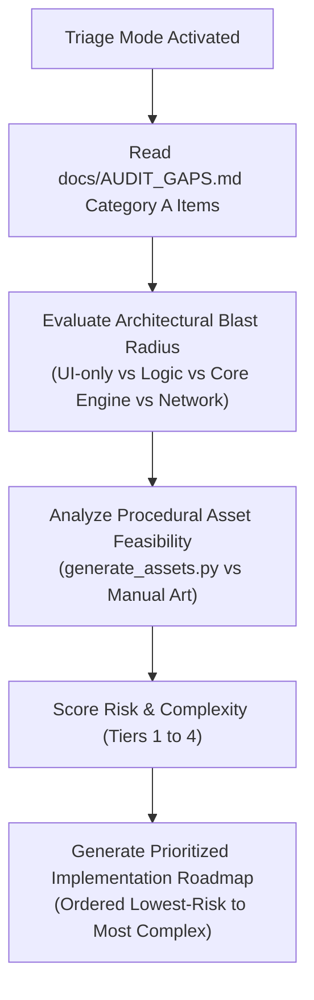

# Documentation Audit & Alignment Skill (`doc-audit`)

This skill provides a standardized, repeatable procedure for auditing, aligning, maintaining,
and triaging the documentation of **Avoid Rain** against the active Python codebase, map data, and assets.

Use this skill whenever:
- Preparing for a milestone release or phase transition.
- Syncing documentation after large feature additions or refactors.
- Auditing discrepancies between game mechanics and design documentation.
- Verifying link integrity, archiving standards, and convention compliance across `docs/`.
- Triaging, ranking, and planning implementation order for Category A roadmap gaps.

---

## 1. Safety Guardrails & Principles

1. **Zero Source Code Modification**: In both Audit and Triage modes, this skill must **never** modify
   game source code (`*.py`), level maps (`maps/*`), or assets (`assets/*`). All file edits are strictly
   restricted to documentation (`docs/`, `AGENTS.md`, and audit reports).
2. **Strict Read-Only Boundary on Game Code**: When triaging or analyzing implementation requirements,
   inspect engine files strictly in read-only mode to assess complexity, architecture, and asset hooks.
   Never generate code patches or mutate game state during a doc audit or triage session.
3. **Lore Preservation**: Never delete active world-building lore, narrative fragments, or artistic
   reference notes from `docs/world_and_lore.md`, `docs/reference.md`, or `docs/extended-notes/`.
   If a lore feature is not yet in code, document it as a pending roadmap item rather than pruning it.
4. **Continuous Cleanup Protocol**: Enforce the repository's strict task lifecycle rule: completed
   tasks must be cut from the active section in `AGENTS.md` and archived in `docs/CHANGELOG.md`.

---

## 2. Phase 1: Convention Compliance & Structural Standards

The Avoid Rain repository enforces a **Hub-and-Spoke** documentation architecture with strict naming
and formatting patterns.

### 2.1 File Organization & Naming Standards

All documentation must reside in one of the following locations:

Path / Pattern                 | Purpose / Content Type                                | Naming Standard
:----------------------------- | :---------------------------------------------------- | :--------------
`AGENTS.md`                    | Central Hub: rules, context pointers, active task     | Exact name
`docs/architecture.md`         | Permanent technical architecture, schemas, state      | Lowercase snake_case
`docs/navigation_and_ui.md`    | Camera, Minimap, HUD, and Input Handling              | Lowercase snake_case
`docs/visual_style_and_assets.md` | Registry of sprites, tile sets, and art blueprints | Lowercase snake_case
`docs/world_and_lore.md`       | Manuscript lore, factions, geographical categories    | Lowercase snake_case
`docs/modular_system.md`       | Map serialization schemas and Master Loom assembly    | Lowercase snake_case
`docs/persistence.md`          | Save/load schemas, statistics, autosave mechanics     | Lowercase snake_case
`docs/backlog.md`              | Roadmap, deferred mechanics, feature proposals        | Lowercase snake_case
`docs/testing.md`              | Headless test execution, mock surfaces, coverage      | Lowercase snake_case
`docs/CHANGELOG.md`            | Historical archive of completed tasks and sprints     | Exact uppercase
`docs/reference.md`            | High-contrast action-RPG visual guides & palettes     | Lowercase snake_case
`docs/level_design_concept.md` | Macro room layouts (Figure-8 loops, choke nodes)      | Lowercase snake_case
`docs/extended-notes/*.md`     | Deep narrative lore, cutscenes, enemy HTML mocks      | Hyphenated lowercase

### 2.2 Task Archiving Convention (Continuous Cleanup Protocol)

Verify that `AGENTS.md` and `docs/CHANGELOG.md` adhere to the continuous archiving lifecycle:
- The active section in `AGENTS.md` must only contain the single currently active sprint task,
  or `## Active Task: [NONE]` when idle.
- Completed tasks must be archived at the bottom of `docs/CHANGELOG.md` using the exact format:
  ```markdown
  ## [ARCHIVED] <Descriptive Task Title> - <Month Year>
  - **Subsystem Category (`file/path.py`, `docs/spec.md`):**
    - Technical bullet points in past tense detailing concrete implementations.
    - Test coverage metrics and verification results.
  ```

### 2.3 Formatting & Link Integrity Rules

- **Line Length**: All markdown text should prioritize readability without overly stretched single-line blocks.
- **Link Formats**:
  - Relative links within `docs/` must point to valid files (e.g. `[Architecture](architecture.md)`).
  - Cross-references to source code must use valid relative paths (e.g. `[engine/combat.py](../engine/combat.py)`).
  - Code symbols must be wrapped in backticks (e.g. `GameState`, `check_sword_hit`, `SWORD_REACH`).

---

## 3. Phase 2: Code-vs-Docs Gap Analysis Protocol

Perform a systematic, subsystem-by-subsystem cross-examination comparing documentation against the codebase.



### 3.1 Subsystem Audit Checklist

Inspect the codebase using file reads and search commands to populate the audit:

#### 1. World, Maps, and Biomes
- Compare `constants.BIOME_PALETTES` and `constants.TILE_KEY` against `docs/reference.md` and `docs/modular_system.md`.
- Inspect `maps/` directory: check that all map files (`windy_ridge.json`, `swamp_mire.json`, `the_colophon.json`,
  `sanctuary_*.txt`, etc.) are documented in `docs/modular_system.md` or `docs/world_and_lore.md`.
- Check room assembly logic in `engine/world_generator.py` (symmetric sizing array `[120, 40, 120, 40, 120]`)
  against `docs/modular_system.md`.

#### 2. Enemies, Minibosses, and Bosses
- Compare `SYMBOL_REGISTRY` in `engine/world.py` and enemy classes in `engine/enemy.py`
  (`BatEnemy`, `SlugEnemy`, `FlutterEnemy`, `BindlingEnemy`, `SmearEnemy`, `SentryEnemy`, `Miniboss`)
  against `docs/architecture.md` and `docs/extended-notes/enemies/`.
- Check Boss implementation in `engine/boss.py` (`NightBoss`) and arena mechanics against `docs/architecture.md`.

#### 3. Combat, Physics, and Equipment
- Compare weapon constants and anomalous traits in `constants.py`, `engine/weapon.py`, and
  `engine/player.py` (`bleed`, `slow_hp_regen`, etc.) against `docs/architecture.md`.
- Verify combat parameters (sword reach, crescent arc radians, dash duration, parry window, block reduction)
  in `constants.py` match the combat specifications in `docs/architecture.md`.

#### 4. UI, Camera, and Visual Systems
- Check Minimap rules (radar color tokens, Sanctuary exclusion, safe circle ring) in `engine/minimap.py` and
  `rendering/renderer.py` against `docs/navigation_and_ui.md`.
- Check audio and debug text visibility controls (pause menu debug toggle, persistent audio HUD)
  against `docs/navigation_and_ui.md`.

#### 5. Persistence and Networking
- Check the save schema (`save_data.json`) in `engine/stats.py` and `engine/autosave.py`
  against `docs/persistence.md`.
- Check client/server network sync (UDP state replication, port reuse, timeout reconnection)
  in `engine/network_manager.py` against `docs/architecture.md`.

### 3.2 Gap Classification Categories

Sort all discovered issues into the following four categories:

1. **Category A (Documented but Unimplemented)**:
   - Features, weapons, enemies, or biomes planned in design docs but not yet found in the engine.
   - Example: Footnote spirits trading in `Market of Margins`, or unimplemented lore fragments.
2. **Category B (Implemented but Undocumented)**:
   - Mechanics, constants, tile types, or enemies present in code but missing from technical docs.
   - Example: New procedural clutter sprites (`ruins_rubble.png`, `swamp_flora.png`, `crypt_clutter.png`),
     or newly added enemy types (`SentryEnemy`).
3. **Category C (Contradictions & Drift)**:
   - Numerical values, names, or formulas that disagree between code and documentation.
   - Example: Sword reach documented as 40px but calibrated to 64px in `constants.py`.
4. **Category D: Broken Links & Stale References**:
   - Markdown links pointing to moved or deleted files, old prototype filenames, or dead anchors.

---

## 4. Phase 3: Triage & Prioritization Mode (Category A Ranking)

When prompted to **triage**, **prioritize**, or **rank** gaps, activate this specialized mode. Triage mode
evaluates all Category A items recorded in `docs/AUDIT_GAPS.md` and design roadmaps, ordering them along a
clear implementation spectrum from lowest-risk to highest-complexity, while assessing procedural asset feasibility.



### 4.1 Strict Read-Only Boundary

Triage & Prioritization mode is **strictly analytical and advisory**:
- **Never modify game source code (`*.py`), level maps (`maps/*`), or assets (`assets/*`) during triage.**
- The output of triage mode is a prioritized strategy report presented in Markdown (and optionally
  recorded in `docs/AUDIT_GAPS.md` under Section 6 Action Items).
- Code changes must occur only in dedicated subsequent coding tasks following user confirmation.

### 4.2 Risk & Complexity Tiers

Rank all Category A gaps across four distinct architectural tiers:

- **Tier 1: Self-Contained Config & UI (Lowest Risk)**
  - Modifies a single menu or config flag with zero collision or physics impact.
  - *Typical Scope*: Options menu toggles, HUD indicators, debug OSD telemetry.
- **Tier 2: Contained Mechanics & Local VFX (Low-to-Medium Risk)**
  - Discrete game logic, local state timers, and contained boundaries.
  - *Typical Scope*: Stamina / Quill Pressure meter, single-tile interactable props.
- **Tier 3: Narrative & Economic Loops (Medium-to-High Risk)**
  - Multi-step dialogue trees, inventory compilers, and economy hooks.
  - *Typical Scope*: NPC artisan shops (The Binder), Market of Margins footnote trading.
- **Tier 4: Cross-Cutting Core Engines (Highest Risk)**
  - Overhauls spatial math, pathfinding, or networking.
  - *Typical Scope*: A* autonomous pathfinding, multiplayer desync stabilization.

### 4.3 Procedural Asset Feasibility via `generate_assets.py`

Avoid Rain features an offline procedural pixel art generator (`generate_assets.py`) using PIL and NumPy
that produces 40x40 transparent dark-fantasy PNG assets adhering to the Scriptorium Noir palette.

During triage, classify the visual requirement of each Category A item into one of three asset categories:

1. **Fully Procedural (`generate_assets.py` Enabled - Zero Manual Art Required)**:
   - The feature requires 2D icons, props, markers, or tokens that fit the existing grit-textured,
     low-contrast procedural pipeline.
   - *Feasible Assets*: Environmental props, NPC static plinths/busts, manuscript glyph tokens, UI meter
     frames, altar dials, clutter items, and consumable pickups.
   - *Guideline*: Note the recommended sprite dimensions (e.g., 40x40 transparent PNG), target export path
     (`assets/graphics/<name>.png`), and palette color constants (e.g., `COLOR_MARGIN_RED`, `COLOR_CANDLE_AMBER`).
2. **Code-Only / Math / Typography (No Assets Required)**:
   - The feature is purely algorithmic, typographic, or state-driven.
   - *Examples*: Accessibility toggles, cooldown timers, screen shake dampening, pathfinding heuristics.
3. **Complex External Art Required (Deferred / High Art Burden)**:
   - The feature requires multi-frame directional walk cycles or bespoke narrative cutscene art.
   - *Guideline*: Flag these for Phase 2 dedicated art passes or recommend procedural geometry/abstract ghost
     fallbacks (`draw_actor_ghost`) to maintain decoupling.

### 4.4 Triage Deliverable Format

When generating a Triage & Prioritization response or updating the audit report, format the output as follows:

```markdown
### Category A Triage & Implementation Roadmap

| Rank | Gap / Feature | Source Doc | Risk Tier | Asset Strategy | Blast Radius |
| :---: | :--- | :--- | :---: | :--- | :--- |
| **1** | Screen Shake Toggle | `backlog.md` | Tier 1 (Lowest) | Code-Only (0 assets) | `stats.py`, `renderer.py` |
| **2** | Quill Pressure | `backlog.md` | Tier 2 (Low-Med) | Procedural icon | `player.py`, `constants.py` |
| **3** | The Binder NPC | `backlog.md` | Tier 3 (Med-High)| Procedural NPC & glyphs | `world.py`, `generate_assets` |
| **4** | Market of Margins | `world_and_lore.md` | Tier 3 (High) | Procedural shop props | `world.py`, `maps/` |
| **5** | A* Pathfinding | `backlog.md` | Tier 4 (Highest) | Code-Only (Algorithms) | `enemy.py`, `world.py` |

#### Detailed Item Breakdown & Implementation Briefs:
- **Rank [X]: <Feature Name>**
  - *Risk Rationale:* Explanation of why this rank was assigned.
  - *Asset Leverage:* Specific `generate_assets.py` function design (if applicable).
  - *Architectural Constraints:* Constants required, dt scaling, testing strategy.
  - *Recommended Next Action:* Concrete first step for the implementation sprint.
```

---

## 5. Phase 4: Safe Cleanup, Archiving, and Reporting

### 5.1 Safe Documentation Cleanup Rules

1. **Fix Broken Links**: Update stale markdown links in `docs/` to point to actual filenames and headers.
2. **Synchronize Constants**: Update documented numbers in `docs/architecture.md` and `docs/navigation_and_ui.md`
   to match canonical constants in `constants.py`.
3. **Catalog Undocumented Additions**: Add missing entries for newly added enemies, tiles, and rendering
   passes into `docs/visual_style_and_assets.md` and `docs/architecture.md`.
4. **Move Obsolete Proposals to Backlog**: If a documented feature was redesigned during development,
   move the old concept into `docs/backlog.md` under an `[Archived Proposal]` section rather than erasing it.

### 5.2 Audit Deliverable: `docs/AUDIT_GAPS.md`

Every full doc-audit run must produce or refresh `docs/AUDIT_GAPS.md` with the standard structure:
Executive Summary, Category A (Unimplemented), Category B (Undocumented), Category C (Contradictions),
Category D (Broken Links), and Action Items / Remediation Plan.

---

## 6. Step-by-Step Execution Runbooks

### Runbook A: General Documentation Audit & Gap Discovery
1. **Survey Documentation**: Scan `docs/` and `docs/extended-notes/`.
2. **Scan Git History**: Check recent doc updates (`git log -n 15 --oneline -- docs/`).
3. **Inspect Archiving Status**: Verify `AGENTS.md` active slot and `docs/CHANGELOG.md`.
4. **Scan Codebase Artifacts**: Grep `SYMBOL_REGISTRY`, `BIOME_PALETTES`, and generated assets.
5. **Verify Markdown Link Integrity**: Check relative file paths and anchors across all markdown files.
6. **Compile Report**: Write or refresh `docs/AUDIT_GAPS.md`.
7. **Synchronize Documentation**: Update core technical specs to reconcile Category B and C gaps.
8. **Verify Verification Tests**: Run `pytest` to guarantee docstring and path assertion safety.

### Runbook B: Triage & Prioritization Mode
1. **Read Active Gaps**: Inspect Section 2 (Category A) in `docs/AUDIT_GAPS.md` and `docs/backlog.md`.
2. **Enforce Read-Only Boundary**: Confirm no source code files (`*.py`, `maps/*`, `assets/*`) are modified.
3. **Analyze Asset Viability**: Inspect `generate_assets.py` to identify procedural PNG opportunities.
4. **Score Risk & Coupling**: Evaluate blast radius across state serialization, physics, and networking.
5. **Generate Ranked Output**: Produce the canonical Triage & Prioritization Matrix ordered lowest to highest risk.
