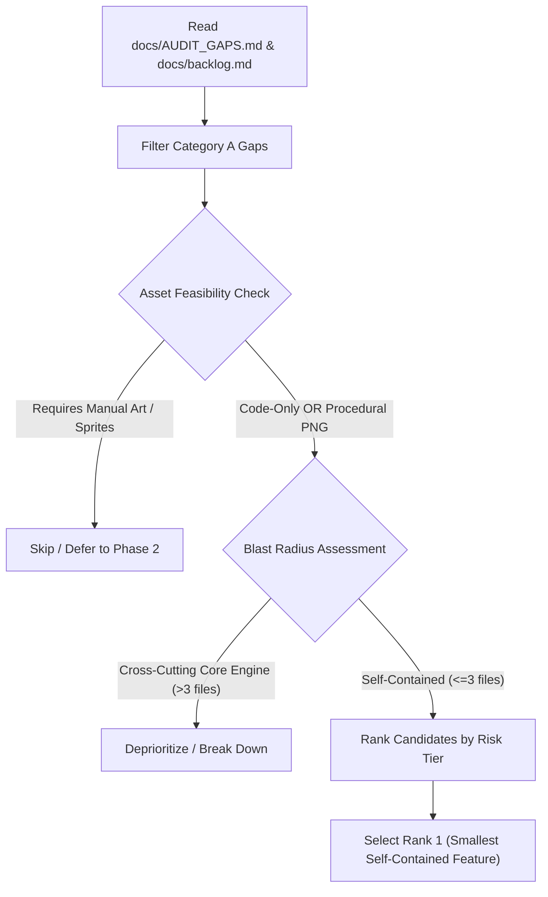
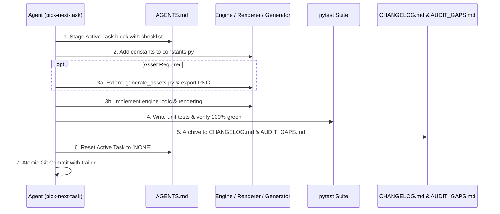

# Autonomous Task Selection & Implementation Skill (`pick-next-task`)

This skill provides an autonomous end-to-end operational protocol for selecting, staging, implementing,
testing, and archiving the next optimal development task in **Avoid Rain**.

It acts as the execution companion to the `doc-audit` skill, converting audited roadmap gaps into fully verified,
tested, and archived production code.

---

## 1. Core Operating Principles

1. **Smallest Viable Slice (SVS)**:
   - Prioritize self-contained, low-risk features that can be implemented, verified, and archived in a single turn.
   - Avoid open-ended refactors or epics that span multiple unrelated subsystems.
2. **Procedural Asset Pipeline First**:
   - Select features that require **zero new visual assets** (code, UI, math, config) OR can fully leverage the
     offline procedural asset pipeline in `generate_assets.py` (40x40 transparent PNGs, grit textures, Scriptorium
     Noir palette).
   - Never pick a feature that requires manual sprite sheets, multi-frame walk cycles, or external art assets.
3. **Strict Architectural Discipline**:
   - **Constants Only**: No magic numbers; all speeds, dimensions, colors, and timers must reside in `constants.py`.
   - **dt Scaling**: Frame-rate independence is mandatory for all timers, movement, and particle physics.
   - **Decoupled Architecture**: Engine logic must remain strictly decoupled from Pygame rendering.
   - **Line Length**: All Python files must adhere to maximum line length of 120 characters.
   - **Code Quality**: All modified files must achieve a `pylint` score of 8.0 or higher (target $\ge 9.5$).
4. **100% Green Test Enforcement**:
   - Every implementation must include comprehensive unit tests in `tests/test_<feature>.py`.
   - The entire test suite (`pytest`) must pass cleanly before any task is declared complete.
5. **Continuous Cleanup Protocol Compliance**:
   - Exactly follow the repository's task lifecycle rule: stage in `AGENTS.md`, execute, archive in `CHANGELOG.md`,
     update `docs/AUDIT_GAPS.md`, and reset `AGENTS.md` to clean.

---

## 2. Selection Heuristic & Decision Matrix

When invoked, the agent executes the following algorithmic selection process:



### 2.1 Filtering Criteria

Evaluate each candidate from Category A in `docs/AUDIT_GAPS.md`:

Criterion | Pass Requirement | Disqualification
:-------- | :--------------- | :---------------
**Asset Feasibility** | Pure code/math OR 40x40 PNG via generator | Requires multi-frame walk cycles or artist sheets
**Blast Radius** | Touches $\le 3$ core source files | Crosses network, physics, and generator at once
**Testability** | Headless unit tests in `pytest` | Requires manual user interaction or live window
**Dependencies** | Zero unfulfilled prerequisites in codebase | Relies on prior unmerged features or schemas

### 2.2 Risk Tier Preference

Select from the lowest available tier:
1. **Tier 1 (Top Priority)**: Self-contained config & UI toggles (e.g. Screen Shake toggle in Options).
2. **Tier 2 (High Priority)**: Contained mechanics & local VFX (e.g. Quill Pressure / Stamina meter).
3. **Tier 3 (Medium Priority)**: Narrative & economic loops with procedural props (e.g. The Binder NPC).
4. **Tier 4 (Lowest Priority)**: Cross-cutting core engines (e.g. A* pathfinding overhaul).

---

## 3. Step-by-Step Execution Protocol



### Phase 1: Task Staging (`AGENTS.md`)
Immediately write the selected feature into the active task slot in `AGENTS.md`:

```markdown
<!-- SINGLE ACTIVE PLACEHOLDER SECTION -->

## Active Task: <Feature Title>

1. Define configuration constants, colors, and parameters in `constants.py`.
2. [Optional] Add procedural asset generator in `generate_assets.py` and export PNG.
3. Implement engine logic with dt scaling and decoupled state management.
4. Wire rendering and HUD feedback in `rendering/renderer.py`.
5. Write dedicated unit tests in `tests/test_<feature>.py` and verify full test suite passes.
6. Execute Continuous Cleanup Protocol, update `docs/AUDIT_GAPS.md`, and commit cleanly.
```

### Phase 2: Configuration & Asset Generation
1. **Constants Configuration**:
   - Add all configuration parameters, dimensions, colors, and timers to `constants.py`.
   - Never hardcode magic numbers in engine or rendering files.
2. **Procedural Asset Pipeline (when applicable)**:
   - If the feature requires visual icons or props, add `generate_<asset>()` to `generate_assets.py`.
   - Utilize existing noise, bevel, grit-texture, and palette patterns (40x40 transparent PNG).
   - Run the script to export the PNG to `assets/graphics/`.
   - Cache the sprite in `Renderer._generate_prop_cache()` or appropriate sprite registry.

### Phase 3: Engine Logic & Rendering Implementation
1. **Engine Logic**:
   - Implement state updates, timers, cooldowns, or toggles in `engine/<module>.py`.
   - Ensure all rate calculations multiply by `dt`.
   - Maintain pure game state logic without importing `pygame` graphics calls in engine files.
2. **Rendering & UI**:
   - Wire drawing logic in `rendering/renderer.py`.
   - Support both active graphical rendering and headless test environments (`_setup_headless_renderer`).

### Phase 4: Strict Verification & Quality Control
1. **Author Unit Tests**:
   - Create `tests/test_<feature>.py` testing state transitions, boundary limits, and math formulas.
   - Test headless draw calls using `monkeypatch` if testing renderer components.
2. **Run Full Test Suite**:
   ```bash
   pytest tests/test_<feature>.py
   pytest
   ```
   *Mandate*: Every single test in the repository must pass (100% green). Never accept regressions.
3. **Lint & Style Checks**:
   ```bash
   pylint constants.py engine/<module>.py rendering/renderer.py tests/test_<feature>.py
   ```
   Ensure score $\ge 8.0$ and line lengths $\le 120$ characters.

### Phase 5: Continuous Cleanup & Archiving (`doc-audit` Protocol)
1. **Archive Task in `docs/CHANGELOG.md`**:
   Append a past-tense entry at the bottom of `docs/CHANGELOG.md`:
   ```markdown
   ## [ARCHIVED] <Feature Title> - <Month Year>
   - **Subsystem Category (`file/path.py`, `tests/test_file.py`):**
     - Concrete implementation details and mechanics.
     - Asset generation and renderer wiring.
     - Test coverage metrics and verification results.
   ```
2. **Update `docs/AUDIT_GAPS.md`**:
   - Mark the item as resolved or move it from Category A to Category B (Remediated).
   - Update the alignment health score.
3. **Reset `AGENTS.md`**:
   Restore the active section to clean state:
   ```markdown
   <!-- SINGLE ACTIVE PLACEHOLDER SECTION -->

   ## Active Task: [NONE]

   Current sprint is complete. Awaiting next directive.
   ```
4. **Atomic Git Commit**:
   - Stage all modified files.
   - Commit with descriptive message and required trailer:
     ```bash
     git commit -m "<type>(<scope>): <concise summary>

     <bullet points detailing changes>

     Co-authored-by: Gemini CLI <gemini-cli@google.com>"
     ```
   - Do NOT push to remote automatically.

---

## 4. Example Execution Walkthrough: Screen Shake Toggle

When `pick-next-task` evaluates current Category A gaps:
1. **Candidates Evaluated**:
   - *A* Pathfinding*: High risk, algorithmic engine, 4+ files touched -> Deprioritized.
   - *The Binder NPC*: Medium-high risk, dialogue tree, script compiler -> Deprioritized.
   - *Quill Pressure*: Medium risk, touches player attack and dash gating -> Secondary candidate.
   - *Screen Shake Toggle*: Tier 1, self-contained UI/Options toggle, zero new assets, 2 files touched -> **Selected**.
2. **Staging**: Active Task set in `AGENTS.md`.
3. **Execution**:
   - Add default preference `screen_shake_enabled` in `constants.py` and `engine/stats.py`.
   - Add toggle option to Pause Menu (`Screen Shake: ON/OFF`) in `rendering/renderer.py`.
   - Check `state.stats.data.get("screen_shake_enabled", True)` before applying camera offset.
4. **Verification**:
   - Add `tests/test_screen_shake_toggle.py` verifying state toggle and renderer offset suppression.
   - Run `pytest` (100% green across all tests).
5. **Archiving**:
   - Archive to `docs/CHANGELOG.md`.
   - Update `docs/AUDIT_GAPS.md`.
   - Reset `AGENTS.md` to `## Active Task: [NONE]`.
   - Commit cleanly.
